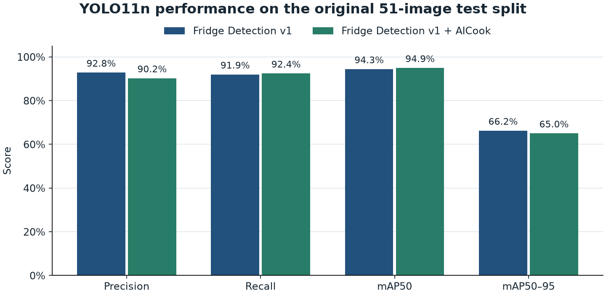
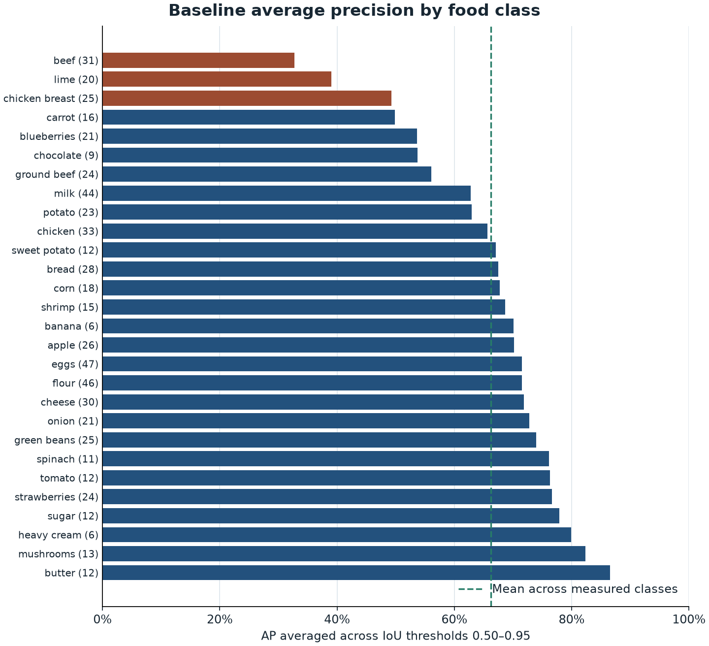
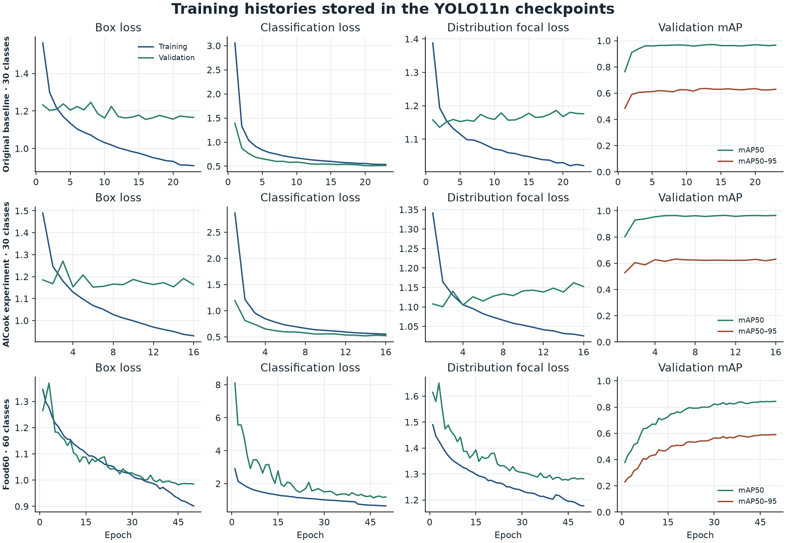

# Fridge2Fork | Group Project 2 Technical Report

**CSCI 270 · Fall 2026**

**Team:** Adwoa A., Owen D., Donavan W., and Carsyn W.

**Report date:** November 20, 2026

## What

Fridge2Fork is an iOS prototype that turns a refrigerator photo into recipe suggestions. The app detects supported foods, shows their locations and confidence scores, and lets the user remove incorrect detections or add missing ingredients. A local API compares the resulting inventory against a 20,000-recipe RecipeNLG subset and returns two groups.

| Result | Rule | What the user sees |
| --- | --- | --- |
| **Make Now** | Zero unmatched recipe ingredients | Matched ingredients, full ingredient list, and directions |
| **Missing 1–2 Items** | One or two unmatched recipe ingredients | Matched and missing ingredients, full ingredient list, and directions |

The iOS app uses a bundled 60-class detector. The separate Python workflow supports experimental OCR-assisted detection and interactive review. [Software design document](docs/SSD.md)

## Why

The project addresses a practical meal-planning problem for students with limited time, budgets, and cooking experience. Starting with ingredients already on hand can make meal choices easier and may reduce unnecessary purchases and food waste. The project has yet to measure either outcome.

- **Object detection.** A refrigerator photo can contain several foods at once. YOLO11n predicts individual boxes and labels, so users can see and check the evidence behind each suggestion. Transfer learning lets the team start from pretrained visual features and fine-tune using the available labeled images.
- **Editable inventory.** Occlusion, lighting, and similar packaging can cause the detector to assign the wrong name or miss a product. Users can correct the inventory before relying on the results. The household-photo review documents the size of this problem for the early baseline. [Review findings](docs/prediction-review-2026-10-26.md)
- **Recipe retrieval and label text.** Existing recipes provide directions and a readable explanation of ingredient coverage. The optional PaddleOCR experiment tests whether readable packaging gives a second clue when appearance alone is ambiguous. [OCR workflow](docs/ocr-guide.md)

## How

### Application and data pipeline

1. **Detect.** The SwiftUI app accepts an image from Photos or Files. Apple Vision runs the bundled Core ML model on the device and displays boxes and confidence scores. The app currently displays detections above a confidence score of 0.15. [iOS detection and inventory code](app_dev_xcode_proj_2_c270/ObjectDetectorService.swift)
2. **Review.** The user can add pantry items and remove or replace labels in the inventory. The app sends the ingredient names and selected preferences to `POST /recipes`.
3. **Match.** The Python service normalizes casing and whitespace, then matches exact names or whole-word subsets against the recipe dataset's extracted ingredient names. Coverage is the number of matched recipe ingredients divided by the number of extracted ingredients. Word-subset matches can conflate ingredients such as `milk` and `coconut milk`. [Recipe matching code](recipe_model.py)
4. **Filter and display.** FastAPI applies keyword-based diet and allergen exclusions and uses cuisine keywords when they return matches. Within each group, the API returns recipes in dataset order, with up to 15 **Make Now** and 20 **Missing 1–2 Items** per response. Users with allergies should verify ingredient lists and product labels independently. [API implementation](server.py)

### Detector training and comparison

The first YOLO11n checkpoint used the 30-class Fridge Detection v1 export. The AICook experiment added 362 training and 103 validation images with the same ingredient names. The dataset builder remapped AICook labels by name to preserve class IDs and kept the original 51 test images. The added source was intended to broaden appearance coverage. The hue setting stayed at 0.015. Saturation decreased from 0.70 to 0.35 and brightness from 0.40 to 0.25 to limit changes to food color. The comparison measures the dataset and augmentation changes together. [Dataset sources and split history](docs/SSD.md#dataset-progression-and-evaluation-boundaries), [original export record](docs/datasets/fridge-detection-v1.md)

Both 30-class checkpoints used 640-pixel inputs, 50 configured epochs, batch size 8, seed 42, and early-stopping patience 10. The comparison below evaluates their saved checkpoints on the same 51-image original test split, containing 610 annotated objects. Evaluation used Ultralytics 8.4.184, PyTorch 2.14.1, 640-pixel inputs, and CPU inference. This retrospective comparison uses the previously inspected test split. The original October 22 evaluation is recorded in the project log. [Decision log](docs/decision-log.md#2026-10-22--iteration-1-full-baseline-and-held-out-evaluation)

| Checkpoint | Train / validation images | Precision | Recall | mAP50 | mAP50–95 |
| --- | ---: | ---: | ---: | ---: | ---: |
| Fridge Detection v1 (`baseline-01`) | 2,994 / 103 | **0.928** | 0.919 | 0.943 | **0.662** |
| Fridge Detection v1 + AICook (`baseline-02`) | 3,356 / 206 | 0.902 | **0.924** | **0.949** | 0.650 |



**Figure 1.** The AICook experiment gained 0.5 percentage points in recall and 0.5 in mAP50, while losing 2.6 points in precision and 1.2 in mAP50–95, using unrounded scores. mAP50 uses the 0.50 intersection-over-union threshold for matching boxes. mAP50–95 averages across thresholds from 0.50 through 0.95 and gives more weight to tight localization. The original baseline scored higher on precision and mAP50–95 for this split. The experiment changed both the data and augmentation, and the small test set leaves uncertainty about how much of the difference would repeat.



**Figure 2.** The baseline's weakest measured classes by AP50–95 were beef (0.327), lime (0.390), and chicken breast (0.492). Parenthetical counts show how many labeled test instances support each score. Goat cheese and ham had zero test instances and are omitted. The source export lacks verified refrigerator and capture-session IDs, so the split's independence at the household level remains unknown.

| Diagnostic plot | Fridge Detection v1 | Fridge Detection v1 + AICook |
| --- | --- | --- |
| Precision–recall | [Baseline](docs/figures/baseline/precision-recall.png) | [AICook](docs/figures/aicook/precision-recall.png) |
| F1 by confidence threshold | [Baseline](docs/figures/baseline/f1-confidence.png) | [AICook](docs/figures/aicook/f1-confidence.png) |
| Precision by confidence threshold | [Baseline](docs/figures/baseline/precision-confidence.png) | [AICook](docs/figures/aicook/precision-confidence.png) |
| Recall by confidence threshold | [Baseline](docs/figures/baseline/recall-confidence.png) | [AICook](docs/figures/aicook/recall-confidence.png) |
| Confusion matrix, counts | [Baseline](docs/figures/baseline/confusion-counts.png) | [AICook](docs/figures/aicook/confusion-counts.png) |
| Confusion matrix, normalized | [Baseline](docs/figures/baseline/confusion-normalized.png) | [AICook](docs/figures/aicook/confusion-normalized.png) |



**Figure 3.** The plots use the histories saved in each checkpoint and span epochs 1 through 23, 16, and 50, respectively. Validation datasets differ by run, so the curves describe each run's training progress. The 51-image comparison in Figure 1 uses identical evaluation data for both 30-class runs.

### Household photos and the release model

The October household-photo review marked **1 of 55 reviewed detections** correct and 54 wrong, with one detection unreviewed. That 1.8% describes the reviewed detections only. The review lacks complete ground-truth boxes and object inventories, so it cannot establish standard precision, recall, or mAP. The result shows why the high scores on the supplied test split are insufficient for judging household performance. [Prediction review](docs/prediction-review-2026-10-26.md), [image comparison](docs/image-comparison-2026-10-26.md)

Later experiments expanded the class vocabulary and produced the 60-class `food60-clean-household-v1` model packaged for iOS. The local Python checkpoint records validation precision **0.850**, recall **0.784**, mAP50 **0.843**, and mAP50–95 **0.590**. Those scores use a different dataset and label set from the 30-class comparison. The public test split and its plots leave the release model's field performance unmeasured. [60-class training configuration](config/train-food60.yaml), [bundled Core ML model](app_dev_xcode_proj_2_c270/best.mlpackage/Manifest.json)

In a four-photo November review with the 60-class Python checkpoint, the OCR pipeline recorded three confirmations, three proposed relabelings, and five text-only candidates compared with YOLO alone. For example, it proposed changing a cheese detection to beans after reading “kidney beans.” These counts describe pipeline actions. The experiment lacks complete annotations to verify which actions improved recognition. Recipe grouping and filtering likewise still need a labeled benchmark. [OCR guide](docs/ocr-guide.md)

### Reproduce the benchmark

Retrieve the original YOLOv11 export and obtain the two 30-class checkpoints from the team. The raw images, weights, and full run directories are local artifacts. The repository includes the aggregate figures above. Run these commands from the repository root in the detector environment. [Dataset retrieval](docs/datasets/fridge-detection-v1.md), [Windows training setup](docs/windows-setup.md)

```bash
python scripts/prepare_dataset.py --raw-root data/fridge-detection-v1 \
  --output-data runs/report-dataset/data.yaml \
  --output-manifest runs/report-dataset/manifest.csv

python scripts/workflow.py evaluate --data runs/report-dataset/data.yaml \
  --manifest runs/report-dataset/manifest.csv --weights baseline-01/best.pt \
  --device cpu --output runs/report-baseline-01

python scripts/workflow.py evaluate --data runs/report-dataset/data.yaml \
  --manifest runs/report-dataset/manifest.csv --weights baseline-02/best.pt \
  --device cpu --output runs/report-baseline-02
```

Use a fresh output directory for each evaluation.

To rebuild the AICook training dataset, download the original, unaugmented 30-class AICook export to `data/aicook-v1/` with its `data.yaml`, images, and labels. The builder requires the same class names in both exports and preserves the original test split. [Data sources and attribution](docs/SSD.md#image-datasets-used-in-the-detection-experiments)

```bash
python scripts/build_combined_dataset.py \
  --baseline-data data/fridge-detection-v1/data.yaml \
  --incoming-data data/aicook-v1/data.yaml \
  --output-root data/combined-aicook-v1
```

To inspect photos and detection boxes interactively, follow the [Rerun viewer guide](docs/rerun-guide.md). For side-by-side YOLO and OCR inference, use `scripts/workflow.py predict --ocr --rerun` with the inputs and environment described in the [OCR setup guide](docs/ocr-guide.md).

### Run the iOS demo

From the repository root on macOS, start FastAPI in a separate environment from the detector.

```bash
python3 -m venv .venv-api
source .venv-api/bin/activate
python -m pip install -r requirements-api.txt
python -m uvicorn server:app --reload
```

On Windows PowerShell, use `py -m venv .venv-api` and `.venv-api\Scripts\Activate.ps1`, then run the same install and server commands. Open <http://127.0.0.1:8000/docs> for the interactive API docs. On macOS with Xcode 27.2, open `app_dev_xcode_proj_2_c270/app_dev_xcode_proj_2_c270.xcodeproj` in Xcode, run the app in an iOS simulator, select a refrigerator image, and review the ingredient list and recipe groups. The simulator uses the API at `127.0.0.1:8000`. A physical iPhone needs the development computer's LAN address in the client and a server listening on that interface, such as Uvicorn started with `--host 0.0.0.0`.

## When

| Date in 2026 | Milestone |
| --- | --- |
| October 19–23 | Prepared and validated the original dataset, trained the 30-class baseline, evaluated it on the supplied test split, and added interactive Rerun review. |
| October 26–31 | Reviewed household-photo detections and trained the second 30-class checkpoint with supplemental AICook images. |
| November 2–9 | Expanded the ingredient vocabulary, added optional OCR, and added the recipe engine and 20,000-recipe subset. |
| November 18–20 | Added the native iOS app, bundled the Core ML detector, and connected the FastAPI recipe service for team testing. |

[Experiment decision log](docs/decision-log.md), [development iteration plan](docs/iteration.md)

## Future Plans

1. **Measure real refrigerator performance.** Collect and annotate images from refrigerators and capture sessions withheld from training and tuning. Report per-class counts, precision, recall, mAP, and confusion matrices for the 60-class model, including results for occluded items and look-alike packaging.
2. **Test whether OCR helps.** Compare YOLO alone with YOLO plus OCR on the same labeled images at matched settings. Record verified corrections, new errors, and the number of manual edits needed per photo.
3. **Validate recipe results.** Build a set of labeled inventories and expected recipe matches. Check missing-item counts, ingredient aliases, cuisine preferences, and restriction handling. Use the results to improve normalization and order the recipe groups by relevance.
4. **Verify the full mobile workflow.** Test on a physical iPhone with representative photos, an unavailable API, and empty results. Measure time from image selection to recommendations and track the number of inventory corrections.
